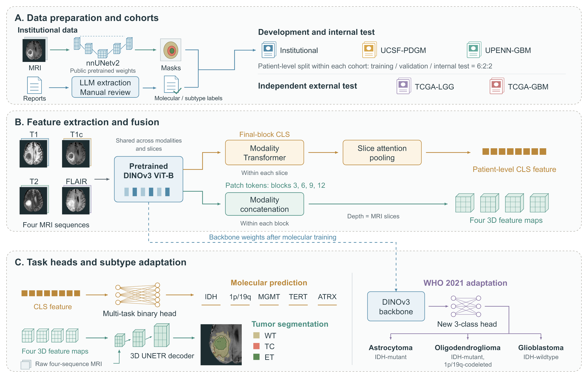

# DINO-Glioma: Harnessing a Natural Image-Pretrained Vision Foundation Model for Joint Molecular Prediction and Tumor Segmentation in 3D MRI

DINO-Glioma uses a pretrained DINOv3 vision transformer to predict **IDH, 1p/19q, MGMT, TERT and ATRX** status and segment **whole tumor (WT), tumor core (TC) and enhancing tumor (ET)** from preoperative multisequence MRI.

## Workflow


## Repository layout

The intended minimal release layout is shown below. All modules imported by the training and evaluation entry points must be included at their expected paths.

```text
.
├── train.py                  # Joint-model training
├── test.py                   # Checkpoint evaluation
├── data/                     # Dataset configuration, splits and transforms
├── models/                   # Shared encoder, classification head and decoder
├── losses/                   # Classification and segmentation losses
├── evaluation/               # Evaluation and metrics
├── helpers/                  # Required logging and checkpoint utilities
└── dinov3/                   # DINOv3 implementation used by the backbone loader
```

## Requirements and weights

The main implementation uses PyTorch, MONAI, NumPy, pandas, scikit-learn, nibabel, Matplotlib, TensorBoard and tqdm. A CUDA-capable GPU is recommended. Exact package versions should match the released environment; DeepSpeed is only needed when using the corresponding training or checkpoint format.

The backbone loader expects the [DINOv3 implementation](https://github.com/facebookresearch/dinov3) under `./dinov3`. Obtain the matching ViT-B pretrained weights from its official distribution. DINOv3 initialization weights and the trained DINO-Glioma checkpoint are different files.

| Weights | Use | Availability |
| --- | --- | --- |
| DINOv3 ViT-B pretrained weights | Initialize joint-model training | Official DINOv3 distribution |
| DINO-Glioma joint checkpoint | Evaluate the trained classification and segmentation model | Download link to be added |

## Input data

Prepare skull-stripped, spatially co-registered T1, T1c, T2 and FLAIR MRI volumes in NIfTI format (`.nii` or `.nii.gz`) for each patient.

Organize the data in `data_splits.json` with three top-level keys: `train`, `val` and `test`. Each key contains a list of patient records. The core record fields are listed below; reference masks and molecular labels provide supervision for training and evaluation.

| Field | Description |
| --- | --- |
| `patient_id` | Patient identifier |
| `flair`, `t1`, `t1ce`, `t2` | Paths to the four MRI volumes; `t1ce` corresponds to T1c |
| `seg` | Path to the segmentation reference |
| `label` | Molecular label list: `0` or `1`, with `-1` for unavailable labels |
| `label_mask` | Corresponding validity list: `1` for valid labels and `0` for unavailable labels |
| `seg_label_type` | Reference-mask source: `manual` or `pseudo` |

Both `label` and `label_mask` follow the task order `IDH`, `1p19q`, `MGMT`, `TERT`, `ATRX`.

## Training

Run from the repository root. The paths below are examples and must be replaced with the supplied data and weight locations. These commands illustrate the current interface; paper-specific training settings must be supplied with the final release rather than inferred from script defaults.

```bash
python train.py \
  --data_splits_dir ./data/splits \
  --pretrained_weights ./weights/dinov3_vitb16.pth \
  --dinov3_backbone_name dinov3_vitb16 \
  --train_mode seg_cls \
  --task_select IDH 1p19q MGMT TERT ATRX \
  --mods_fusion attention \
  --slice_pool attention \
  --fine_tune \
  --output_dir ./outputs
```

`--data_splits_dir` is the **directory containing** `data_splits.json`. `--fine_tune` enables full backbone fine-tuning; omitting it freezes the backbone. For ordinary PyTorch training, the joint checkpoint is saved as `best_checkpoint/best_joint_model.pth`.

## Evaluation

For a complete ordinary PyTorch checkpoint:

```bash
python test.py \
  --data_splits_dir ./data/splits \
  --checkpoint ./outputs/RUN_ID/best_checkpoint \
  --weight_tag best_joint_model.pth \
  --train_mode seg_cls \
  --tasks IDH 1p19q MGMT TERT ATRX \
  --strict_load True \
  --output_dir ./outputs/evaluation
```

`--checkpoint` specifies the checkpoint **directory**, while `--weight_tag` identifies the weights within it. Explicitly specify all five tasks: the current test-script default evaluates IDH only. The complete joint checkpoint supplies both the trained backbone and task heads, so separate backbone initialization weights are not needed for this command. Evaluation writes metrics under `outputs/evaluation/test_results/`.

## Notes

- Match task order, modality order, backbone configuration and preprocessing to the checkpoint. Keep missing molecular labels masked rather than converting them to negative labels.
- Preserve reference-mask provenance. Internally generated nnUNetv2 masks are automated references and should not be described as manual annotations.
- Keep the evaluation grid and empty-reference-region policy consistent when comparing Dice scores. The reported overall Mean Dice is the unweighted average of the three regional cohort means.
